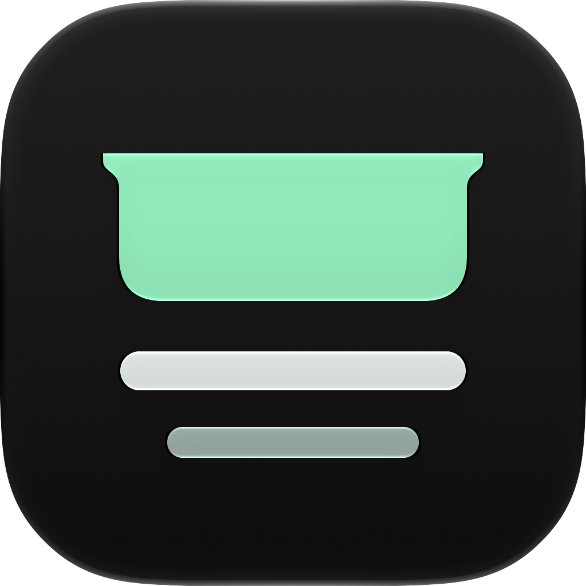

# NotchLyrics



A small macOS menu bar companion for Spotify, with synced lyrics in the notch.
Built with SwiftUI and AppKit. Personal beta, shared with friends.

[**Download the DMG**](https://github.com/denjayx/NotchLyrics/releases/tag/v0.1.0-beta.1) · [Report an issue](https://github.com/denjayx/NotchLyrics/issues)

## Requirements

- macOS 13 or newer.
- Spotify desktop installed locally; browser playback and remote Spotify Connect are not supported.
- Apple Silicon or Intel. The universal binary contains both architectures; runtime verification has only been performed on Apple Silicon.
- Internet access to fetch lyrics and album artwork.

## Install

Download `NotchLyrics-0.1.0-beta.1-universal.dmg` from **Releases → Assets**, open it, then drag **NotchLyrics.app** to **Applications**. Eject the disk image and launch the installed app.

**This beta is ad-hoc signed and not notarized by Apple.** macOS may block the first launch. If you trust the release, attempt to open it once, then go to **System Settings → Privacy & Security → Open Anyway** and confirm. Managed Macs may disallow this. Do not disable Gatekeeper globally. [Apple’s opening instructions](https://support.apple.com/en-us/102445).

Open Spotify and allow NotchLyrics to control it when prompted. No Dock icon appears: the app lives in the menu bar.

## Use

- Hover the notch/top-center edge to reveal the player and three lyric lines.
- Use previous, play/pause and next without switching to Spotify.
- Pin keeps the main panel open.
- Settings opens a separate tools island with **Always show lyric** and **Audio delay**.
- Positive timing makes lyrics appear earlier; negative timing makes them appear later. Audio playback itself is unchanged.
- The floating lyric pill hides while paused, while the main panel is open, or when the pointer approaches it.
- Quit using the music-note menu bar item → **Keluar**, or right-click the notch.

Lyrics depend on [LRCLIB](https://lrclib.net). Some tracks have no synced lyrics or use different timing for live/remastered versions. Spotify supplies track metadata and playback position; the app fetches timestamps and selects the active lyric locally.

## Privacy

Track title, artist, album and duration are sent to LRCLIB to find lyrics. Artwork is fetched from the URL supplied by Spotify. There is no analytics, account system or saved listening history. Preferences are stored locally; lyrics are cached in memory while the app is running.

## Build from source

Use macOS with Xcode 27 (the toolchain verified for this release), its command-line tools selected, and its license accepted. No third-party package dependencies.

```sh
./build.command          # Build universal app and open it
./package-dmg.command    # Build, sign ad hoc, package and verify DMG
```

Outputs: `NotchLyrics.app` and `dist/`. The build compiles `Assets/NotchLyrics.icon` with Apple's `actool`, including native icon resources and an ICNS fallback. Open the `.icon` document in Icon Composer to edit its three vector layers.

For distribution signing, set `NOTCHLYRICS_SIGN_IDENTITY` to your Developer ID Application identity. The build enables hardened runtime and the Apple Events entitlement. **Signing alone does not notarize the app**; submit and staple the distribution separately before claiming it is notarized.

## Beta limitations

Only the first display is targeted. Multi-monitor arrangements, fullscreen behavior and older macOS releases need more testing. Lyric timing is interpolated from Spotify's playback position; it is not sample-accurate audio synchronization. This release has no auto-updater: download future versions from Releases.

See [technical documentation](TECHNICAL.md) for implementation details. [Release notes](docs/RELEASE-NOTES.md) record what was verified for this beta.

## License and credits

[MIT](LICENSE), © 2026 Deni Wijaya. The license applies to this project's code and original assets, not third-party lyrics, album artwork or trademarks. Not affiliated with Spotify or Apple. Lyrics provided by [LRCLIB](https://lrclib.net); native icon authored with Apple Icon Composer.
